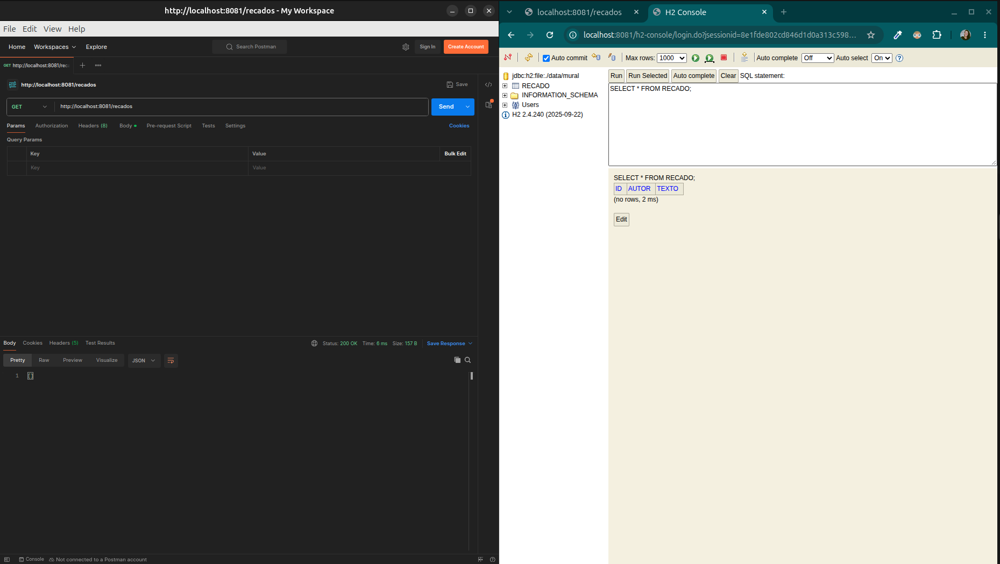
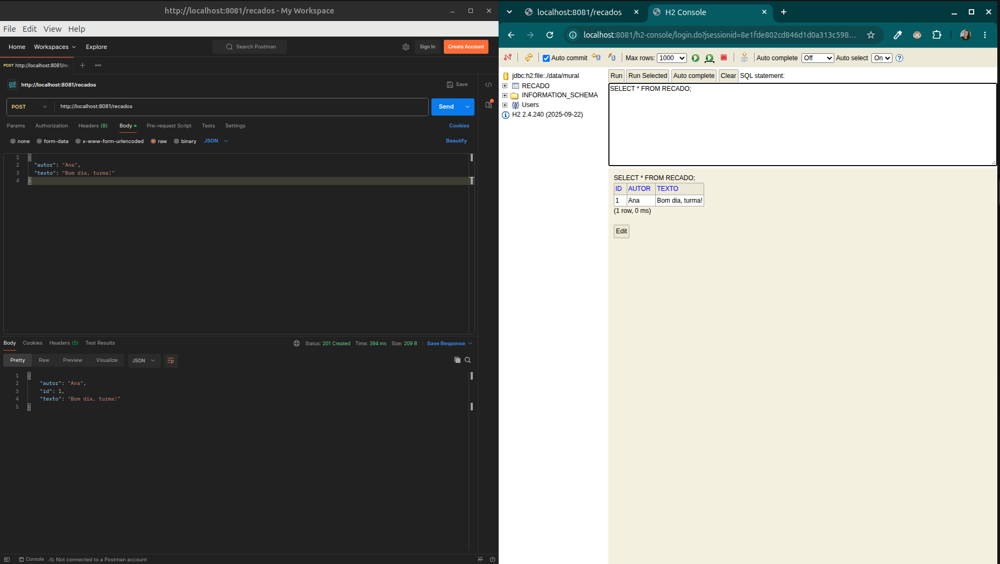

# Message Board: Mural de Recados

API REST feita com Spring Boot onde qualquer pessoa pode deixar um recado.
Projeto de estudo sobre arquitetura em camadas (MVC), HTTP e persistência com JPA.

## Tecnologias

- Java 17
- Spring Boot (Web, Data JPA)
- H2 Database (em arquivo)
- Maven

## Estrutura do projeto

```
messageboard/
├── src/
│   ├── main/
│   │   ├── java/com/projeto/messageboard/
│   │   │   ├── MessageboardApplication.java
│   │   │   ├── model/Recado.java
│   │   │   ├── repository/RecadoRepository.java
│   │   │   ├── service/RecadoService.java
│   │   │   └── controller/RecadoController.java
│   │   └── resources/application.properties
│   └── test/java/com/projeto/messageboard/
│       └── MessageboardApplicationTests.java
├── data/            (arquivos do banco H2, criados ao rodar)
├── pom.xml
└── README.md
```

> Os pacotes `model`, `repository`, `service` e `controller` precisam ficar **dentro** do pacote da classe com `@SpringBootApplication`. Fora dele, o Spring não os encontra e a API responde 404.

## Como executar

Pré-requisito: JDK 17 (`java -version` e `javac -version`).

Na raiz do projeto (onde está o `pom.xml`):

```bash
./mvnw clean spring-boot:run
```

A aplicação sobe em `http://localhost:8080` (ou na porta definida em `server.port`).

Se a porta estiver ocupada:

```bash
fuser -k 8080/tcp
```

## Configuração (`application.properties`)

```properties
spring.datasource.url=jdbc:h2:file:./data/mural
spring.datasource.driverClassName=org.h2.Driver
spring.datasource.username=sa
spring.datasource.password=

spring.jpa.hibernate.ddl-auto=update
spring.jpa.show-sql=true

spring.h2.console.enabled=true
spring.h2.console.path=/h2-console
```

## Endpoints

| Método | Rota       | Descrição               | Status |
|--------|------------|-------------------------|--------|
| GET    | `/recados` | Lista todos os recados  | 200    |
| POST   | `/recados` | Cadastra um novo recado | 201    |

### Exemplo de requisição

```http
POST /recados
Content-Type: application/json

{
  "autor": "Ana",
  "texto": "Bom dia, turma!"
}
```

### Exemplo de resposta

```json
{
  "id": 1,
  "autor": "Ana",
  "texto": "Bom dia, turma!"
}
```

## Testando no Postman

1. Novo request, método **POST**, URL `http://localhost:8080/recados`.
2. Aba **Body** → **raw** → **JSON**, e cole o JSON do recado.
3. **Send** → esperado `201 Created` com o `id` preenchido.
4. Envie mais dois recados com autores diferentes.
5. **GET** `http://localhost:8080/recados` → devem voltar os três.
6. Pare o servidor, rode de novo e repita o GET → os três continuam lá.

Alternativa com curl:

```bash
curl -X POST http://localhost:8080/recados \
  -H "Content-Type: application/json" \
  -d '{"autor":"Ana","texto":"Bom dia, turma!"}'

curl http://localhost:8080/recados
```

## Console do H2

Abra `http://localhost:8080/h2-console` e preencha:

| Campo        | Valor                        |
|--------------|------------------------------|
| Driver Class | `org.h2.Driver`              |
| JDBC URL     | `jdbc:h2:file:./data/mural`  |
| User Name    | `sa`                         |
| Password     | (vazio)                      |

```sql
SELECT * FROM RECADO;
```

> A tela de login vem com a URL padrão `jdbc:h2:~/test`. Se não trocar o JDBC URL, aparece o erro "Database not found".

## Problemas comuns

| Sintoma | Causa | Solução |
|---|---|---|
| `release version 25 not supported` | `pom.xml` pede Java 25 e o JDK é 17 | Trocar `<java.version>` para `17` |
| `./mvnw: No such file or directory` | Terminal fora da raiz do projeto | `cd` até a pasta do `pom.xml` |
| `Port 8080 was already in use` | Execução anterior ainda aberta | `fuser -k 8080/tcp` ou mudar `server.port` |
| 404 em `/recados` | Controller fora do pacote da aplicação, ou arquivo vazio/não salvo | Conferir `package` e salvar os arquivos |
| `class, interface, enum, or record expected` | Texto estranho no início de um `.java` | Conferir a primeira linha (`package ...;`) |
| `Unable to find a single main class` | Duas classes com `@SpringBootApplication` | Manter só uma e rodar `clean` |
| 415 no POST | Body não está como JSON | Body → raw → JSON |

---

# Conceitos e perguntas de revisão

## Spring, MVC, REST e HTTP no projeto

**HTTP** é o protocolo de pedido e resposta entre cliente e servidor. Um pedido tem método, URL, headers e body. Uma resposta tem status code, headers e body.

**REST** é o estilo de desenhar APIs sobre HTTP: recursos identificados por URLs (`/recados`), ações expressas pelos métodos HTTP, dados em JSON, servidor sem estado e status codes com significado.

**MVC** separa o código por responsabilidade. Aqui: `Recado` é o Model, o JSON devolvido faz o papel da View, e `RecadoController` é o Controller. O projeto acrescenta as camadas Service e Repository.

**Spring** é o framework que cria os objetos, injeta as dependências, embute o servidor Tomcat e converte JSON em objetos e vice-versa.

```
Cliente (Postman)
   │  HTTP
   ▼
Controller  → traduz HTTP para chamadas Java
   ▼
Service     → regras de negócio
   ▼
Repository  → conversa com o banco
   ▼
Banco H2    → tabela RECADO
```

Anotações principais:

| Anotação | Significado |
|---|---|
| `@SpringBootApplication` | Ponto de partida; o Spring escaneia os pacotes abaixo dele |
| `@RestController` | A classe responde requisições HTTP e devolve dados (JSON) |
| `@RequestMapping("/recados")` | Prefixo de todos os endpoints da classe |
| `@GetMapping` / `@PostMapping` | O método atende GET / POST |
| `@RequestBody` | Converte o JSON recebido em objeto |
| `@ResponseStatus(CREATED)` | A resposta sai com 201 em vez de 200 |
| `@Service` | Classe de regra de negócio gerenciada pelo Spring |
| `@Entity`, `@Id`, `@GeneratedValue` | A classe vira tabela; o campo é a chave primária gerada |

---

## Perguntas e respostas

### 1. O que é uma API REST? Pra que ela serve?

É uma interface que permite que programas conversem com outros programas pela internet usando HTTP. Ela expõe recursos (recados, equipamentos) em URLs e usa os métodos HTTP para indicar a ação. Serve para separar o backend de quem o usa: o mesmo backend atende um site, um app de celular ou o Postman.

### 2. Qual a diferença entre GET, POST, PUT e DELETE? Dê um exemplo de cada.

| Método | Ação | Exemplo |
|---|---|---|
| **GET** | Buscar dados | `GET /recados` lista os recados |
| **POST** | Criar | `POST /recados` com o JSON do novo recado |
| **PUT** | Substituir/atualizar | `PUT /recados/1` com o JSON corrigido |
| **DELETE** | Remover | `DELETE /recados/1` apaga o recado 1 |

GET não altera nada; os outros três modificam dados.

### 3. O que significam os status 200, 201, 400, 404 e 409?

- **200 OK**: deu certo (ex.: GET devolveu a lista).
- **201 Created**: o recurso foi criado (resposta do POST).
- **400 Bad Request**: pedido inválido (JSON malformado ou dados que falharam na validação).
- **404 Not Found**: o recurso ou a URL não existe (ex.: `GET /recados/999`).
- **409 Conflict**: o pedido conflita com o estado atual (ex.: cadastrar um equipamento com patrimônio que já existe).

### 4. O que é JSON?

Formato de texto para representar dados em pares chave-valor:

```json
{ "autor": "Ana", "texto": "Bom dia, turma!" }
```

É leve, legível e entendido por praticamente toda linguagem, por isso virou o padrão das APIs.

### 5. Qual a função de cada camada: Controller, Service e Repository?

- **Controller**: porta de entrada. Recebe a requisição HTTP, converte o JSON, chama o Service e devolve a resposta com o status certo. Não tem regra de negócio.
- **Service**: regras de negócio (ex.: "não aceitar patrimônio repetido"). Orquestra o que precisa acontecer.
- **Repository**: único ponto que fala com o banco (salvar, buscar, apagar).

### 6. O que a anotação `@Entity` faz?

Diz ao JPA que a classe representa uma tabela. `Recado` vira a tabela `RECADO`, cada atributo vira uma coluna e cada objeto vira uma linha. O `@Id` marca a chave primária.

### 7. Por que o repository é uma interface, e quem escreve o código dele?

Porque você só declara o que quer, e o **Spring Data JPA gera a implementação em tempo de execução**. Ao ver `extends JpaRepository<Recado, Long>`, ele cria uma classe com `save`, `findAll`, `findById`, `deleteById` etc., já com o SQL necessário.

### 8. O que é validar? O que o `@Valid` faz?

Validar é conferir se os dados recebidos atendem às regras (nome não vazio, número positivo, e-mail válido) **antes** de usá-los. As regras são declaradas na entidade (`@NotBlank`, `@Size`, `@Min`...). O `@Valid` no parâmetro do controller manda o Spring executar essas verificações:

```java
public Recado cadastrar(@Valid @RequestBody Recado recado)
```

Se algo falhar, o Spring lança uma exceção e responde 400 sem executar o método.

### 9. Como um JSON vira uma linha no banco? Do Postman até a tabela.

1. O Postman envia `POST /recados` com o JSON no body.
2. O Tomcat recebe e o Spring MVC encontra o método com `@PostMapping`.
3. O Jackson converte o JSON em um objeto `Recado` (`@RequestBody`).
4. Se houver `@Valid`, as validações rodam aqui.
5. O Controller chama `service.cadastrar(recado)`.
6. O Service chama `repository.save(recado)`.
7. O Hibernate gera `INSERT INTO recado (autor, texto) VALUES (?, ?)` e executa no H2.
8. O banco gera o id e o objeto volta com ele preenchido.
9. O Jackson converte o objeto em JSON e o Spring responde `201 Created`.

### 10. E o caminho contrário: num `GET /equipamentos/1`, como uma linha vira JSON?

1. O Spring casa a URL com um `@GetMapping("/{id}")` e extrai o `1` com `@PathVariable`.
2. O Controller chama o Service, que chama `repository.findById(1)`.
3. O Hibernate gera `SELECT ... FROM equipamento WHERE id = 1`.
4. A linha retornada vira um objeto `Equipamento`, com cada coluna no atributo correspondente.
5. O Controller devolve o objeto, o Jackson o transforma em JSON (usando os getters) e o Spring responde `200 OK`.

### 11. Num `POST /equipamentos/cadastrar`, como o Spring sabe qual método chamar?

Ao iniciar, ele escaneia as classes com `@RestController` e monta uma tabela de rotas juntando as anotações: `@RequestMapping("/equipamentos")` na classe + `@PostMapping("/cadastrar")` no método = `POST /equipamentos/cadastrar`. Quando a requisição chega, o `DispatcherServlet` compara método HTTP + caminho com essa tabela e chama o método correspondente. Sem correspondência, responde 404.

### 12. O `@Valid` barrou o pedido. O Service ficou sabendo? E o banco?

Nenhum dos dois. A validação acontece antes do método do controller executar. A exceção é lançada, o Spring responde 400 e o fluxo termina ali. O Service não é chamado e nenhum SQL é executado.

### 13. Diferença entre `@NotBlank` na entidade e `nullable = false` no `@Column`

| | `@NotBlank` | `@Column(nullable = false)` |
|---|---|---|
| Quem aplica | Bean Validation (Java) | O banco de dados |
| Quando | Antes do método rodar, na entrada | No `INSERT`/`UPDATE` |
| Resultado | 400 com mensagem amigável | Erro de integridade do banco |
| Barra | `null`, vazio `""` e só espaços | Apenas `null` |

Por que os dois? É **defesa em camadas**. O `@NotBlank` dá uma resposta rápida e clara ao cliente. O `nullable = false` garante a integridade mesmo que o dado chegue por outro caminho (outro serviço, um script, um bug que pulou a validação). O banco é a última barreira. Repare que `""` passa pelo `nullable = false`, mas é barrado pelo `@NotBlank`.

### 14. Ontem os dados sumiam ao reiniciar, hoje não somem. O que mudou, e onde?

Mudou a URL do banco no `application.properties`. Antes o H2 usava **memória** (`jdbc:h2:mem:...`, padrão), apagada quando o servidor para. Agora usa **arquivo**:

```properties
spring.datasource.url=jdbc:h2:file:./data/mural
```

Os dados ficam em `data/mural.mv.db` e são lidos de novo na próxima execução.

### 15. Quem cria as tabelas? Em algum momento escrevemos `CREATE TABLE`?

Não escrevemos. Quem cria é o **Hibernate**, por causa da propriedade:

```properties
spring.jpa.hibernate.ddl-auto=update
```

Ao iniciar, ele lê as classes com `@Entity`, compara com o banco e executa os `CREATE TABLE` (ou `ALTER TABLE`) necessários. Com `update`, cria o que falta e preserva os dados. Com `create-drop`, recria tudo a cada execução e apaga no final. Com `show-sql=true`, os comandos aparecem no log.

### 16. `existsByPatrimonio` é só um nome. Como o Spring sabe o que fazer?

Por **convenção de nomes**. O Spring Data JPA decompõe o nome do método:

- `exists` → verificar existência (retorna `boolean`)
- `By` → início do filtro
- `Patrimonio` → o atributo `patrimonio` da entidade

Ele gera algo como `SELECT count(*) > 0 FROM equipamento WHERE patrimonio = ?`. Funciona também com `findByAutor`, `findByAutorAndTexto`, `countByAutor`, `deleteByAutor` e outros. O nome do atributo precisa existir na entidade, escrito igual; se estiver errado, a aplicação nem sobe. Para consultas mais complexas, usa-se `@Query` com JPQL/SQL escrito à mão.

---

## Próximos passos

- Validação dos campos (`@NotBlank`, `@Valid`)
- `GET /recados/{id}` e `DELETE /recados/{id}`
- Tratamento de erros (400 e 409) com `@RestControllerAdvice`
- Testes automatizados

### 5 - 




