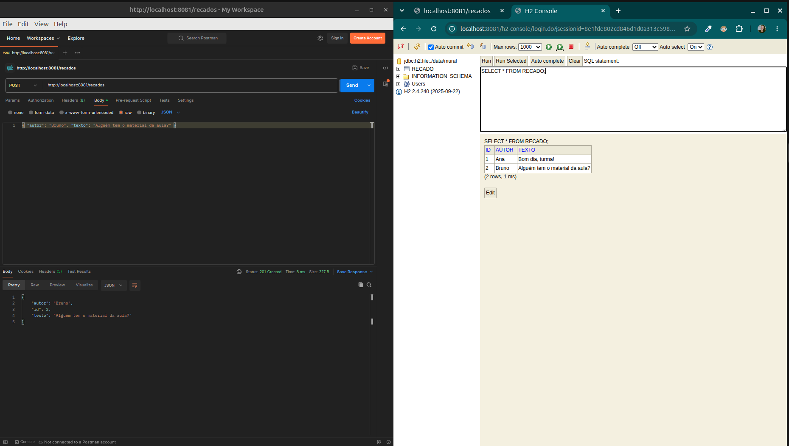
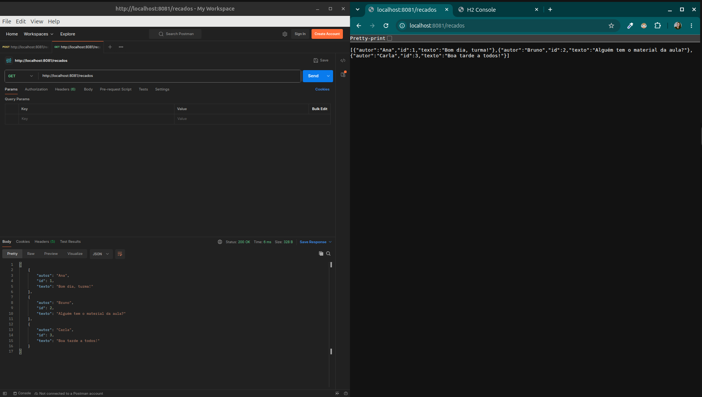

# Mural de Recados

API REST feita com Spring Boot onde qualquer pessoa pode deixar um recado.
Projeto de estudo sobre arquitetura em camadas (MVC), HTTP e persistência com JPA.

## Tecnologias

- Java 17+
- Spring Boot (Web, Data JPA)
- H2 Database (em arquivo)
- Maven

## Estrutura do projeto

```
src/main/java/com/projeto/emprestimos/
├── model/        → entidades (Recado)
├── repository/   → acesso ao banco (RecadoRepository)
├── service/      → regras de negócio (RecadoService)
└── controller/   → endpoints REST (RecadoController)
```

## Como executar

Pré-requisito: Java instalado.

```bash
./mvnw spring-boot:run
```

A aplicação sobe em `http://localhost:8080`.

## Endpoints

| Método | Rota       | Descrição                | Status |
|--------|------------|--------------------------|--------|
| GET    | `/recados` | Lista todos os recados   | 200    |
| POST   | `/recados` | Cadastra um novo recado  | 201    |

### Exemplo de requisição

```http
POST /recados
Content-Type: application/json

{
  "autor": "Ana",
  "texto": "Bom dia, turma!"
}
```

### Exemplo de resposta

```json
{
  "id": 1,
  "autor": "Ana",
  "texto": "Bom dia, turma!"
}
```

## Banco de dados

Os dados ficam salvos no arquivo `./data/mural`, então persistem entre execuções.

Console do H2: http://localhost:8081/h2-console

- JDBC URL: `jdbc:h2:file:./data/mural`
- Usuário: `sa`
- Senha: (vazia)

```sql
SELECT * FROM RECADO;
```

## Arquitetura

Cliente → **Controller** → **Service** → **Repository** → **Banco (H2)**

- **Controller:** recebe e responde requisições HTTP.
- **Service:** concentra a lógica da aplicação.
- **Repository:** persiste e consulta os dados via Spring Data JPA.
- **Model:** representa a tabela do banco (`@Entity`).

## Próximos passos

- Validação dos campos (`@NotBlank`)
- Endpoint de exclusão (`DELETE /recados/{id}`)
- Testes automatizados

### 5 - 





